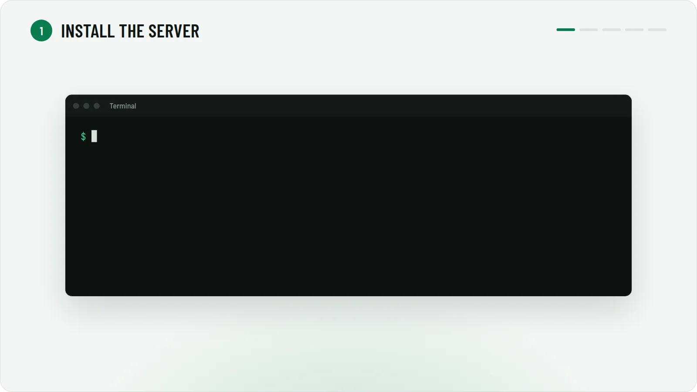

# Play PES 2021 Online Again

<picture>
  <source media="(prefers-color-scheme: dark)" srcset="docs/hero-dark.webp">
  
</picture>

Konami shut down the PES 2021 servers. Host your own and play online with your friends again. Free, no accounts.

**What works:** Quick Match, Online Co-op (one player per side), Online Divisions, Matchday, Friendly Match Lobby,
a Friends Cup every month, and match replays.

## Get started

<p align="center"><picture>
  <source media="(prefers-color-scheme: dark)" srcset="docs/walkthrough-dark.webp">
  
</picture></p>

### 1. Host: install the server

On a Linux PC or Steam Deck that stays on while you play, run this in a terminal:

```bash
curl -fsSL https://raw.githubusercontent.com/AzrakHQ/pes2021-online-server/main/run.sh | sh
```

The server installs itself (no sudo), runs in the background, starts when you log in, and opens its **admin page**.
Everything else happens there: inviting friends, players, results, updates. To open it again, use
**PES 2021 Server** in your apps menu.

### 2. Host: invite your friends

Admin page → **Invite friends** → **Copy message**, then paste it to your friends. The link has their file and the
steps.

### 3. Friends: drop in one file and play

Friends can play on Windows, Linux or Steam Deck.

1. Put `dinput8.dll` in the game folder (Steam: right-click **PES 2021** → **Manage** → **Browse local files**).
2. **Linux / Steam Deck only:** PES 2021 → **Properties** → **Launch options**, paste
   `WINEDLLOVERRIDES="dinput8=n,b" %command%`
3. Start the game → **eFootball** → **Quick Match**. The first time, the game asks for your player name.

The mod changes nothing outside the game folder. To undo, delete the file.

## Problems?

| Problem | Fix |
|---|---|
| A friend can't connect | The host's server must be on. The mod writes what it tried to `pes2021-online.log` in the game folder. |
| "Router ports are closed" on the host | Turn on **UPnP** in the router and start the server again, or forward the ports it lists. |
| The match ends right after kick-off | Both players download the mod again from the invite link, and the host updates the server (admin page → **Server** → **Update now**). |
| Something else | Running the install line again repairs the server; players and results are kept. |

---

[How PES 2021's online mode works](https://azrakhq.github.io/pes2021-online-server/) ·
[Hosting tips and developers](server/README.md) · Fan preservation project, not affiliated with Konami.
