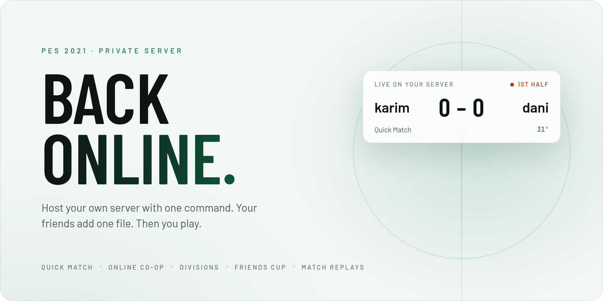
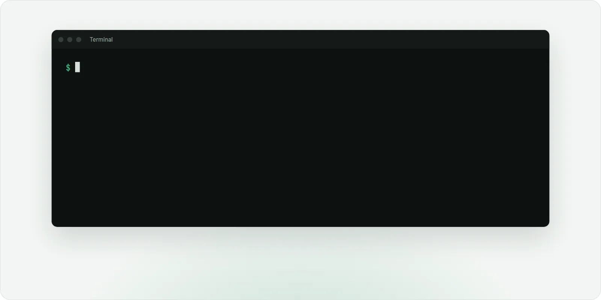
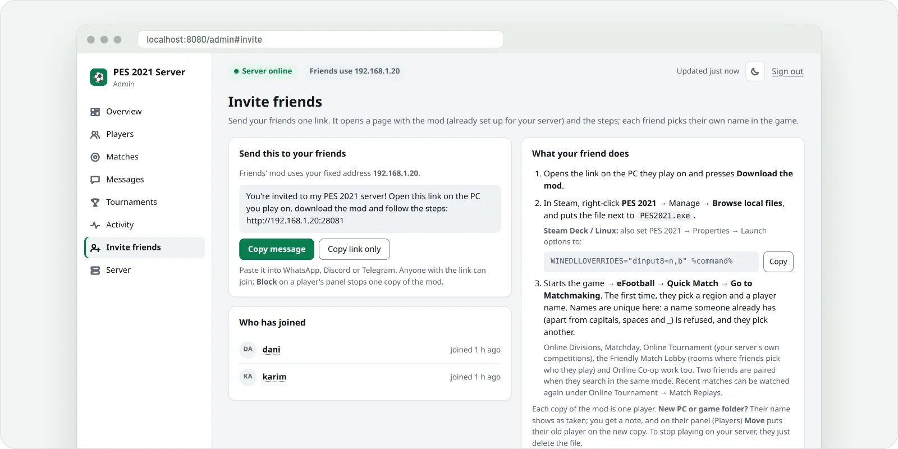
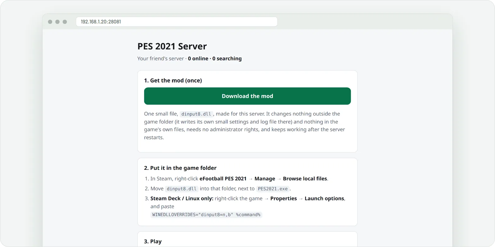
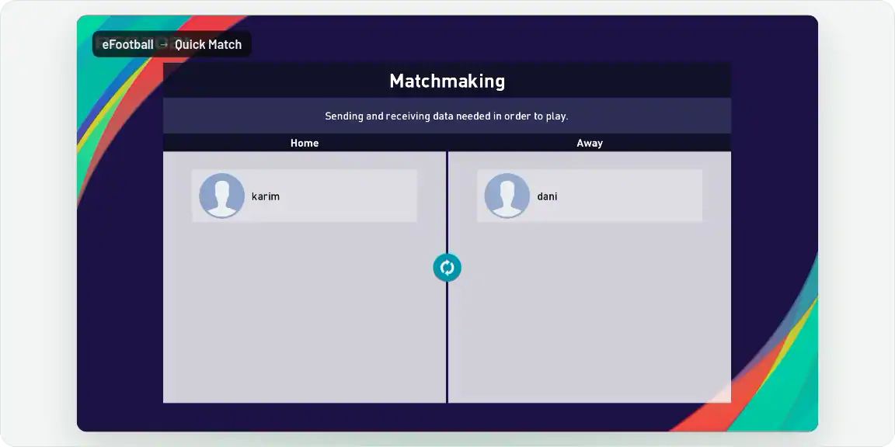

<picture>
  <source media="(prefers-color-scheme: dark)" srcset="docs/hero-dark.webp">
  
</picture>

<h1 align="center">PES 2021 Online Server</h1>

<p align="center">Konami shut down PES 2021's online servers. This brings them back: free, open source, no accounts.</p>

<p align="center">
  <a href="https://github.com/AzrakHQ/pes2021-online-server/actions/workflows/program.yml"></a>
  <a href="https://github.com/AzrakHQ/pes2021-online-server/releases/tag/program"></a>
  <a href="LICENSE"></a>
  
  
</p>

## What works

- **Quick Match**: matchmaking with your friends and full matches, both halves, fouls, cards and half-time.
- **Online Co-op**: Casual Match, one player per side with CPU teammates.
- **Online Divisions**: ten divisions, ten-match seasons, promotion and relegation, rating changes and rankings.
- **Matchday**: one standing event; pick Home or Away and every match adds points for your side.
- **Friendly Match Lobby**: make a room (with a password if you like), your friend picks it, and you stay in the room for a rematch.
- **Friends Cup**: a new tournament every month, with its own table under Rankings.
- **Match replays**: every online match is recorded; watch the newest 20 from Online Tournament → Match Replays.
- **Profiles and stats**: your avatar, favourite team and comment, Last 20 results, and a ranking of everyone on your server.
- **Fair play**: leaving a match early counts as a 3–0 loss, and anyone can block an opponent so they're never matched again.
- **Admin page** for the host: who's online, live matches, results, a league table with seasons, replays, blocking players, backups, Discord notices and one-click updates.

## How to use

### 1. Install the server

On a Linux PC or Steam Deck that stays on while you play:

```bash
curl -fsSL https://raw.githubusercontent.com/AzrakHQ/pes2021-online-server/main/run.sh | sh
```

<p align="center"><picture>
  <source media="(prefers-color-scheme: dark)" srcset="docs/step1-dark.webp">
  
</picture></p>

### 2. Invite your friends

Admin page → **Invite friends** → **Copy message**, and send it to your friends.

<p align="center"><picture>
  <source media="(prefers-color-scheme: dark)" srcset="docs/step2-dark.webp">
  
</picture></p>

### 3. Add the mod (each friend)

Open the link, press **Download the mod**, and put `dinput8.dll` next to `PES2021.exe`.
On Linux or Steam Deck, also set the game's launch options to `WINEDLLOVERRIDES="dinput8=n,b" %command%`.

<p align="center"><picture>
  <source media="(prefers-color-scheme: dark)" srcset="docs/step3-dark.webp">
  
</picture></p>

### 4. Play

**eFootball** → **Quick Match**. The first time, the game asks for your player name.

<p align="center"><picture>
  <source media="(prefers-color-scheme: dark)" srcset="docs/step4-dark.webp">
  
</picture></p>

## FAQ

<details><summary><b>Is it free? Do I need an account?</b></summary>

Free and open source (MIT). No accounts: each copy of the mod is one player, and the game asks for a name the first time.
</details>

<details><summary><b>Can friends outside my home join?</b></summary>

Yes. The server opens your router's ports by itself (UPnP). If it says "Router ports are closed", turn on **UPnP** in
your router settings and start the server again, or forward the ports it lists.
</details>

<details><summary><b>A friend can't connect</b></summary>

The host's server has to be running. The mod writes what it tried to `pes2021-online.log` in the game folder.
</details>

<details><summary><b>The match ends right after kick-off</b></summary>

Both players download the mod again from the invite link, and the host updates the server
(admin page → **Server** → **Update now**).
</details>

<details><summary><b>How do I update the server?</b></summary>

The admin page tells you when a new version is out: press **Update now**. Players and results are kept.
</details>

<details><summary><b>Does the mod change my game?</b></summary>

No. It changes nothing outside the game folder and nothing in the game's own files. To undo, delete `dinput8.dll`.
</details>

<details><summary><b>Something else is broken</b></summary>

Run the install line again: it repairs the server and keeps players and results.
More fixes: [Troubleshooting](server/README.md#troubleshooting).
</details>

<details><summary><b>What doesn't work yet?</b></summary>

myClub, events and official rankings, and Online Co-op with two or three people on a side.
</details>

<br>

<p align="center">
  <a href="https://azrakhq.github.io/pes2021-online-server/"><b>How it works</b></a>
  &nbsp;&nbsp;·&nbsp;&nbsp;
  <a href="server/README.md#hosting-tips"><b>Hosting tips</b></a>
  &nbsp;&nbsp;·&nbsp;&nbsp;
  <a href="server/README.md"><b>For developers</b></a>
  &nbsp;&nbsp;·&nbsp;&nbsp;
  <a href="LICENSE"><b>MIT license</b></a>
</p>

<p align="center"><sub>A fan preservation project by <a href="https://github.com/AzrakHQ">Azrak</a>. Not affiliated with Konami.</sub></p>
