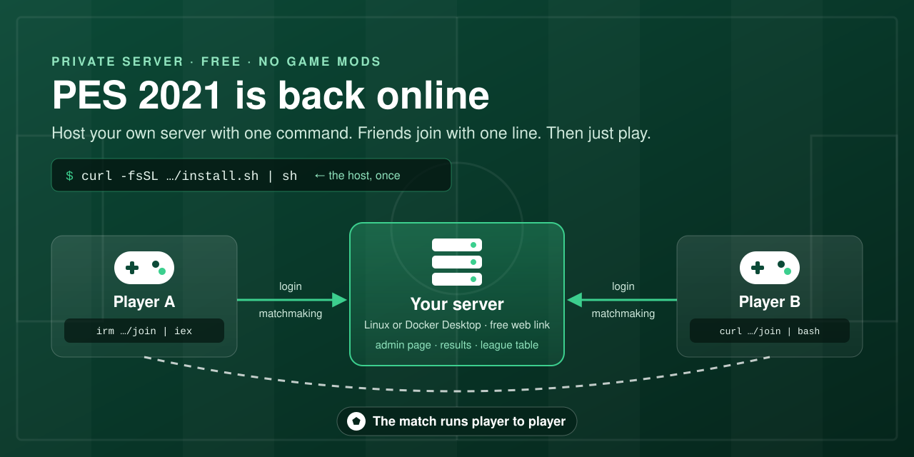

# Play PES 2021 Online Again

<p align="center"></p>

Konami shut down the PES 2021 servers. Run your own and play **online Quick Match** with your friends.
Free, no accounts.

You need **PES 2021 on Steam** (v1.01.00). The host needs a **Linux** PC or **Steam Deck** that stays on while you
play; nothing else to install. Friends can play on Linux, Steam Deck or Windows.

## 1. Host: install the server (once)

In a terminal:

```bash
curl -fsSL https://raw.githubusercontent.com/MohamedAliRashad/pes2021-private-server/main/run.sh | sh
```

It downloads the server (one program, about 30 MB, no sudo), sets it up to run **in the background** (it starts by
itself when you log in), adds **PES 2021 Server** to your apps menu, opens the **admin page** in your browser and
shows the server's screen (admin page address, password, then who comes online and every result, live). **Ctrl+C**
closes that view; the server keeps running, so you can close the terminal.

In a terminal later:

- `pes2021-server`: the server's screen again, live (it starts the server if it isn't running).
- `pes2021-server stop`: stops it. `pes2021-server open`: opens the admin page.

From then on everything is on the admin page:

- **Server → The server program:** **Update now** (or **Update when nobody's playing**) when a new version is out,
  **Restart**, **Stop the server**, **Start when I log in**, and the recent log.
- To open the admin page again, or to start a stopped server: **PES 2021 Server** in your apps menu.
- On the server's own PC the admin page opens without a password; other devices on your Wi-Fi (or Tailscale) use the
  password shown on the Server page. To open it from anywhere, turn on **Admin page from the internet** on its
  Network card (HTTPS: the browser warns once, since the certificate is the server's own).

Options (after `sh -s --`): `--here` runs it in the terminal instead (Ctrl+C stops it), `--no-autostart` doesn't
start it when you log in, `--data DIR` keeps players and results somewhere else. Running the line again repairs the
setup and updates the program; players, results and friends' mods are kept. Already ran an older version in a
terminal? Close it (Ctrl+C), then run the line once.

## 2. Host: invite your friends

Open the admin page → **Invite friends** → **Copy message**, and paste it into Discord, WhatsApp or Telegram. The
link opens a page with the mod (already set up for your server) and the steps; you never send files yourself.

Each copy of the mod is one player. The first time, the game asks for a name: the server keeps it lowercased with
`_` for spaces (`Mohamed Rashad` → `mohamed_rashad`, letters of any language), and a name someone already has
(apart from capitals, spaces, `_`, `-` and `.`) is refused with the game's own "There is already a User with that
name." A friend on a **new PC or game folder** gets that message for their own name: you see a note, and on their
panel (Players) **Move** puts their old player (name, rating, results) on the new copy. **Block** on a player's
panel stops their copy from signing in.

**PES 2021 on the server's own PC** gets the mod by itself: the server finds it (Steam libraries and `~/Games`)
and, while the game is closed, puts the mod in and keeps it up to date, Wine option included. A copy with another
mod is left alone; **PES 2021 on this computer** (Server page) has the switch and the buttons.

## 3. Friends: drop it in and play

1. Put `dinput8.dll` in the game folder: in Steam, right-click **PES 2021** → **Manage** → **Browse local files**.
2. **Steam Deck / Linux only:** PES 2021 → **Properties** → **Launch options**, paste:
   ```
   WINEDLLOVERRIDES="dinput8=n,b" %command%
   ```
3. Start the game → **eFootball → Quick Match → Go to Matchmaking**. When two players are searching,
   they get matched.
4. For a league among friends: **eFootball → Online Tournament → Friends Cup** (a new one every month).
   Pick a team, press Start Match, and the table in **Competition Menu → Rankings** keeps the points
   (win 3, draw 1).

The mod needs no administrator rights and changes nothing outside the game folder (it writes its own small settings and log file there) or in the game's own files. **Undo:**
delete the file.

## Problems?

| Problem | Fix |
|---|---|
| A friend can't connect | The host's server must be running. The mod writes what it tried to `pes2021-online.log` in the game folder |
| "Router ports are closed" on the host | Turn on **UPnP** in your router settings and start the server again, or forward the ports it lists |
| The match ends right after kick-off ("unforeseen circumstances") | A Windows player and a Linux / Steam Deck player computed the match differently. Both download the mod again from the friends' link (version 0.4.0 or newer keeps their games in step), and the host updates the server (admin page → Server → **Update now**) |
| "Failed to connect with opponent" | The two PCs can't reach each other directly. Everyone installs [Tailscale](https://tailscale.com); the host runs the install line again with `PUBLIC_IP=<host's Tailscale IP>` before `sh` (`curl -fsSL … \| PUBLIC_IP=100.x.y.z sh`) |
| Play on another server | Get that server's file and replace yours, or hold **Shift** while the game starts and paste its address |

**New players:** the first time a friend goes online with the mod (eFootball → Quick Match), the game asks for a
region and a player name, and your server saves that player, tied to their copy of the mod. They appear on the
admin page, where you can also block, move or delete a player.

**Updating:** the admin page tells you when a newer version is out; press **Update now** (Server page, or the banner).

<details><summary><b>Set up earlier with a join line?</b></summary>

The old join lines still work. To switch to the mod, run the undo line once, then use the file:
Windows `irm https://mohamedalirashad.github.io/pes2021-private-server/leave.ps1 | iex`,
Linux `curl -fsSL https://mohamedalirashad.github.io/pes2021-private-server/leave.sh | bash`.
</details>

---

**Website:** [mohamedalirashad.github.io/pes2021-private-server](https://mohamedalirashad.github.io/pes2021-private-server/):
how PES 2021's online mode works, in plain words.
Developers: [`server/README.md`](server/README.md), the mod's source is in [`server/mod/`](server/mod/).
Fan preservation project, not affiliated with Konami.
